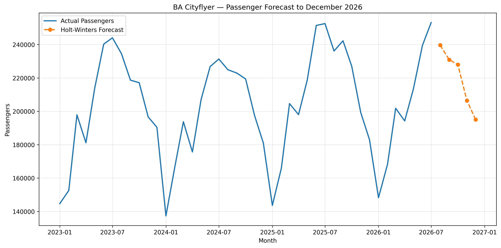

# British Airways Airline Performance & Passenger Forecasting

## Project overview

This project analyses British Airways and UK aviation data using official Civil Aviation Authority (CAA) datasets.

The aim is to explore airline performance, passenger traffic, capacity, route performance and trends over time, and to identify commercially useful insights from the data.

## Project objectives

- Analyse British Airways passenger traffic and capacity.
- Identify trends and seasonal patterns.
- Examine changes in airline performance over time.
- Develop relevant airline performance KPIs.
- Apply statistical and forecasting techniques where appropriate.
- Translate the analysis into commercial and operational insights.

## Tools

- Python
- pandas
- NumPy
- Matplotlib
- Jupyter Notebook
- Git and GitHub

## Data source

UK Civil Aviation Authority (CAA) airline statistics.

## Jupyter notebooks

The analysis is organised into four notebooks:

1. [CAA Airline Data Audit](notebooks/01_caa_airline_data_audit.ipynb) — Data cleaning, validation and preparation.
2. [BA Cityflyer Performance Analysis](notebooks/02_ba_cityflyer_performance_analysis.ipynb) — Passenger traffic, flights, capacity and load factors.
3. [BA Airline Comparison](notebooks/03_ba_airline_comparison.ipynb) — Comparison of BA Cityflyer, BA Euroflyer and British Airways PLC.
4. [BA Cityflyer Forecasting](notebooks/04_ba_cityflyer_forecasting.ipynb) — Seasonal analysis, forecasting models, backtesting and future passenger projections.

## Key findings

### BA Cityflyer performance

Comparing 2019 with 2025:

- Annual passengers decreased from 2.83 million to 2.52 million (-10.79%).
- Annual flights decreased by 27.20%.
- Average passengers per flight increased from 66.68 to 81.72 (+22.55%).
- Passenger load factor increased from 74.70% to 78.92%, an improvement of 4.22 percentage points.

These findings suggest that BA Cityflyer carried more passengers per flight despite operating fewer flights.

### Airline comparison

The analysis compared BA Cityflyer, BA Euroflyer and British Airways PLC between 2023 and 2025.

In 2025, passenger load factors were:

- BA Cityflyer: 78.92%
- BA Euroflyer: 78.82%
- British Airways PLC: 84.17%

### Forecasting and backtesting

Three forecasting methods were evaluated:

- Seasonal Naive
- Seasonal Linear Regression
- Holt-Winters exponential smoothing

Seasonal Naive achieved the lowest MAPE in the January–July 2025 backtest (6.45%).

Holt-Winters achieved the lowest MAPE in the January–July 2026 backtest (1.73%).

The final Holt-Winters model forecasts approximately 1.10 million BA Cityflyer passengers between August and December 2026.

Forecast accuracy varied between the two test periods, so the projections should be interpreted with appropriate caution.

## Passenger forecasting chart

The chart below shows historical BA Cityflyer passenger numbers
from January 2023 to July 2026, followed by Holt-Winters forecasts
for August to December 2026.

## Project status

The airline-level data analysis and forecasting stages are complete.

Four Jupyter notebooks cover:

- CAA airline data acquisition, cleaning and auditing.
- BA Cityflyer passenger and capacity performance.
- Comparisons between BA Cityflyer, BA Euroflyer and British Airways PLC.
- Passenger forecasting using Seasonal Naive, Seasonal Linear Regression and Holt-Winters models, including historical backtesting.

The completed airline-level analysis and passenger forecasting project is published on GitHub, including four Jupyter notebooks, analytical charts and documented findings.

Route-level analysis and an interactive Tableau dashboard remain potential future extensions.
